

  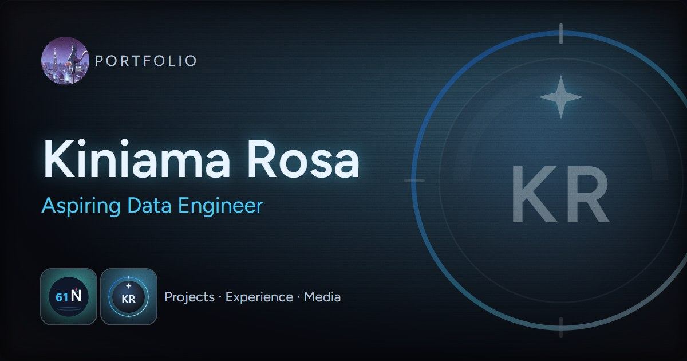

<h1 align="center">kinirosa.com</h1>

  <b>A developer portfolio you play like a game console.</b> 
  <a href="https://kinirosa.com"><b>▶ Play it at kinirosa.com</b></a>

---

Most portfolios are a page you scroll. This one is a console home screen: projects are app tiles, the background changes with whatever you select, a Control Center rises from the bottom, and everything works the same with a keyboard, a mouse, a touchscreen or a game controller. It's styled like a late-night early-2000s bedroom CRT: soft phosphor glow, a dusty spotlight, and sound and music that are generated live in the browser.

It's also a real portfolio underneath. Recruiters can get the essentials in seconds through a quick view, the text is real, crawlable HTML, and the whole thing passes an automated accessibility audit.

  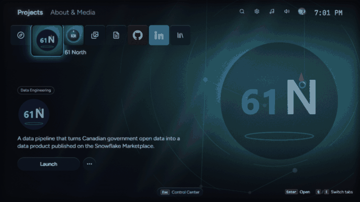

## What's inside

| | |
|---|---|
| 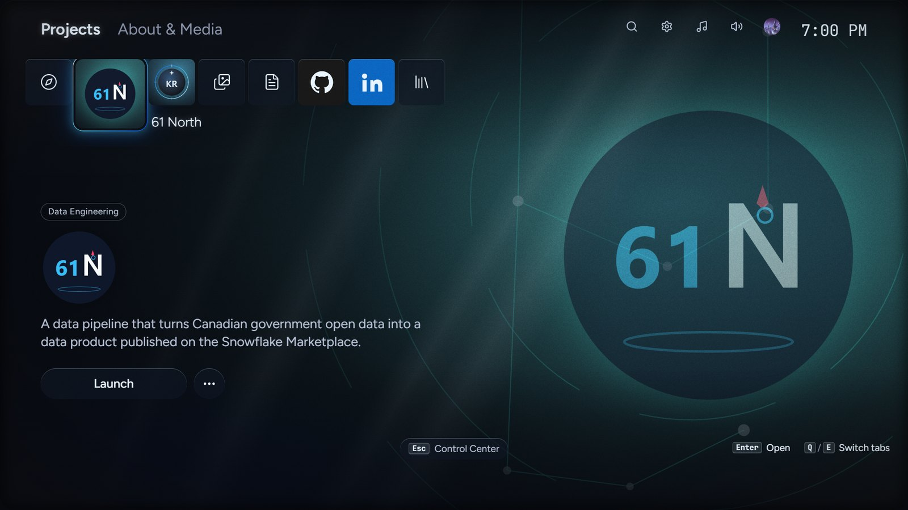 | 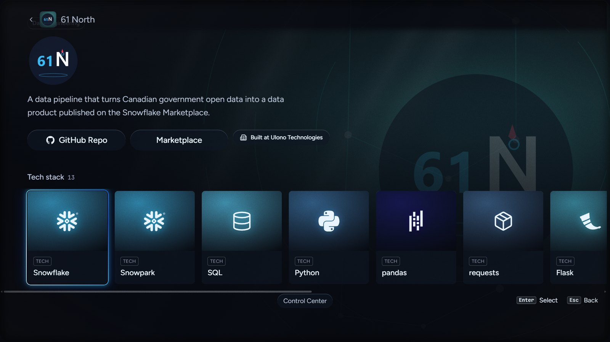 |
| **Home.** A row of app tiles; the selected one fills the screen with its art and a short pitch. | **Project pages.** Hero, links, tech stack with real logos, screenshots and write-ups. |
| 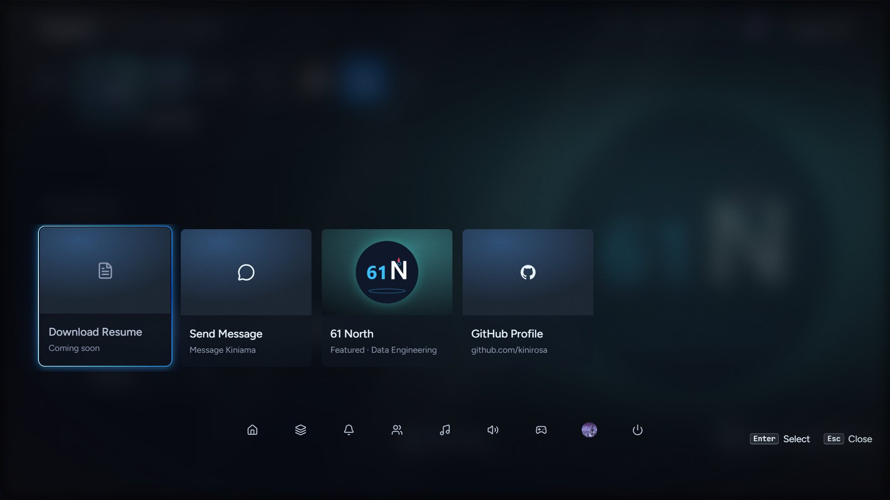 | 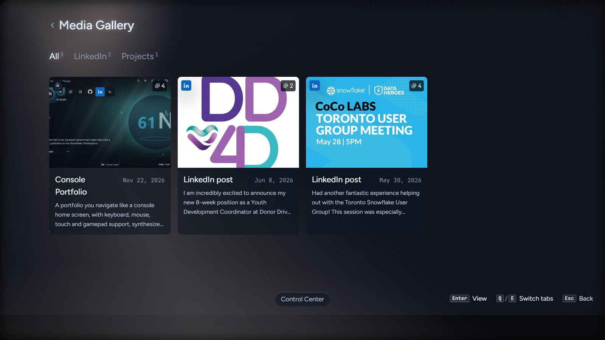 |
| **Control Center.** Quick actions, contact form, music player, sound and controls, in a dock. | **Media Gallery.** LinkedIn posts and project screenshots with a full-screen viewer. |
| 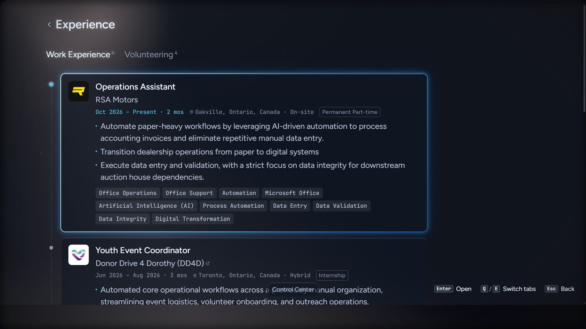 | 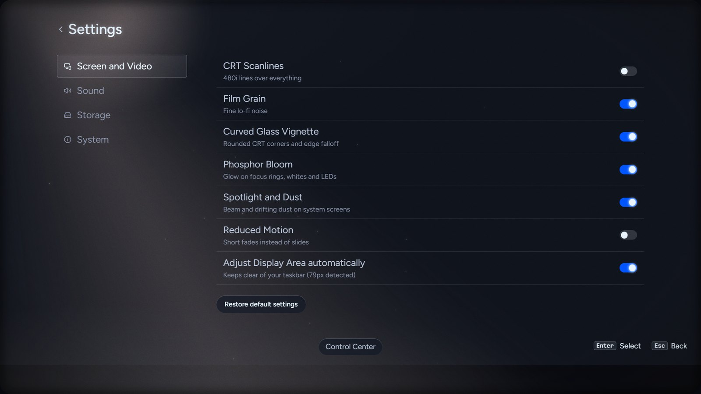 |
| **Experience.** Work and volunteering on a timeline, with organisation logos. | **Settings.** Every visual effect, sound level and motion setting is the visitor's choice. |

  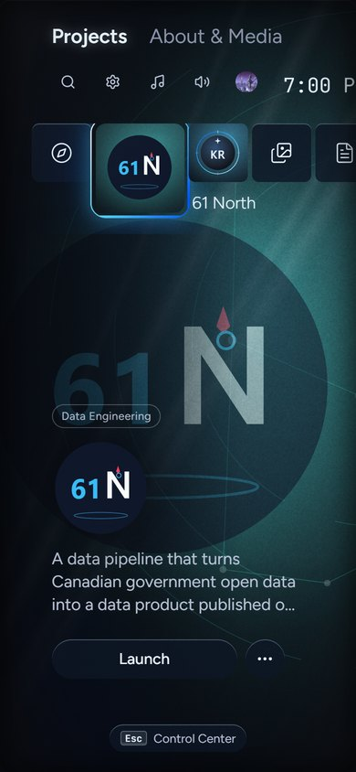
  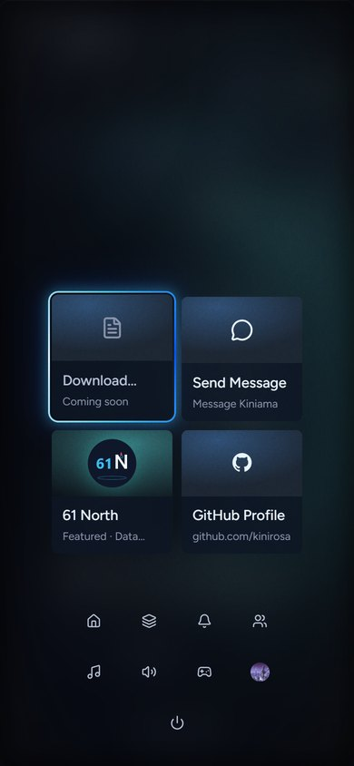
  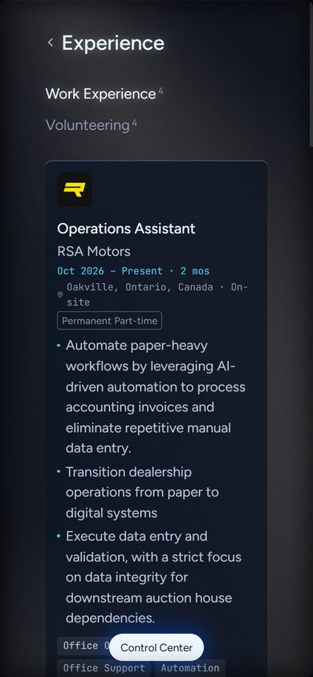

<i>The same console on a phone: tap and swipe instead of arrow keys.</i>

## Highlights

- **One input system for everything.** Keyboard, mouse, scroll wheel, touch and gamepad all drive a single focus model, so there's always one clearly highlighted thing and every input moves it the same way.
- **Sound with no audio files.** Interface sounds and three music tracks are synthesized in real time with the Web Audio API. Nothing plays until the visitor asks.
- **CRT atmosphere, optional.** Bloom, film grain, vignette and a spotlight with drifting dust. Each layer can be switched off, and reduced-motion preferences are respected everywhere.
- **Content is data.** Every name, project, role and post comes from one content file, so updating the portfolio never means touching the interface.
- **Fast.** Screens and overlays load only when opened; the first screen draws in well under a second.
- **Accessible.** Real buttons and links, labelled dialogs, visible focus, and zero issues in an automated WCAG 2.1 AA audit.
- **Private by design.** No cookies, no analytics, no trackers, no third-party scripts. Strict browser security headers allow nothing but the site's own files.

## Read more

- [How it works](docs/how-it-works.md): the focus model, input, screens and content
- [Design](docs/design.md): the console layout, the CRT look, sound and motion
- [Privacy and security](docs/privacy-and-security.md): what the site does (and doesn't) do with visitors

## Built with

React · TypeScript · Vite · Tailwind CSS · Motion · Zustand · Web Audio API · Playwright · Cloudflare

## About the source

This repository is a showcase. The application's source code is private. You're welcome to explore the live site and these notes, but the design, code and content are not licensed for reuse. See [LICENSE](LICENSE).

Fan-made design inspired by console interfaces. Not affiliated with Sony Interactive Entertainment. All visuals, the emblem and every sound are original.

---

  Made by <b>Kiniama Rosa</b> ·
  <a href="https://kinirosa.com">kinirosa.com</a> ·
  <a href="https://github.com/kinirosa">GitHub</a> ·
  <a href="https://www.linkedin.com/in/kiniama-rosa-43a180310/">LinkedIn</a>

