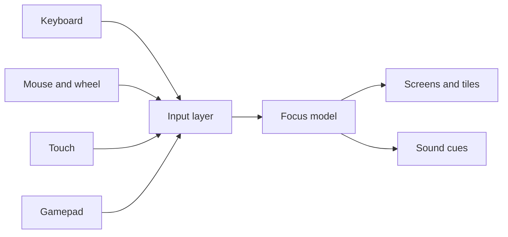
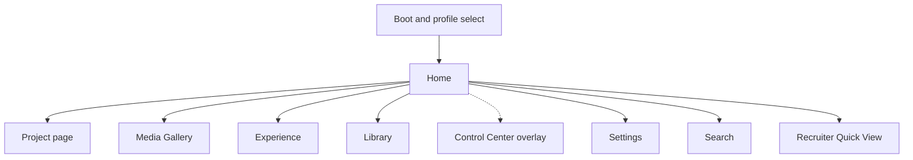

# How it works

A tour of the ideas behind the console, at the level of "what and why". The implementation itself is private.

## One focus model for every input

A console never makes you hunt for the mouse cursor: there is always exactly one highlighted thing, and every control moves it. The site works the same way.

- **Every interactive element registers itself** with a central focus model, grouped into rows, columns and grids. Arrow keys, a D-pad, a swipe or the scroll wheel all become the same "move up/down/left/right" request.
- **Moving between groups is spatial.** Leaving a row goes to the nearest group in that direction, and sideways moves only pick targets that line up, so the highlight never jumps diagonally somewhere surprising.
- **Groups remember where you were.** Leave a row and come back, and you land on the tile you left.
- **Layers stack like a console.** Opening the Control Center, a pop-up or the photo viewer adds a layer on top; Back (Esc, ○ or Backspace) closes it and returns focus to exactly where it came from.
- **The mouse joins in without fighting.** Hovering moves the highlight only after a short rest, a resting pointer never steals focus, and clicks do what Enter does.
- **The scroll wheel adapts.** Over the Home row it flips through tiles; on long pages it scrolls normally and the highlight follows to whatever is on screen.

## Screens and navigation

- **Every screen has its own link** (for example `kinirosa.com/#media`), so a page can be shared directly and opens without the intro.
- **Screens load on demand.** Only Home ships up front; everything else downloads the first time it's opened, which keeps the first visit fast.
- **A recruiter Quick View** gives the essentials (featured project, links, stack) on one plain page for anyone who doesn't want to play.

## Content as data

Every name, bio, project, role, logo and post lives in one typed content file. The interface only reads from it, so:

- adding a project or a job is a data change, not a design change;
- unknown details simply stay empty, and the interface shows a calm "coming soon" instead of placeholder text;
- the same data generates the page's share preview and search metadata at build time.

## Sound

There are no audio files. Interface sounds (move, select, back, open) and three looping music tracks are synthesized in the browser with the Web Audio API, mixed through separate volume buses, and only start after the visitor's first interaction. Music is always opt-in.

## Quality checks

- Type checking, linting and a production build on every change.
- Screenshots at desktop, ultrawide, tablet and phone sizes, compared against the design.
- Keyboard-only and reduced-motion walkthroughs.
- An automated accessibility audit across every screen and overlay.
- A build guard that fails if development-only sample content ever reaches production.
